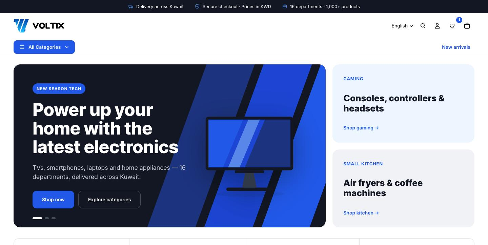
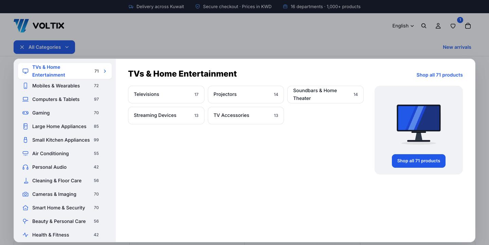
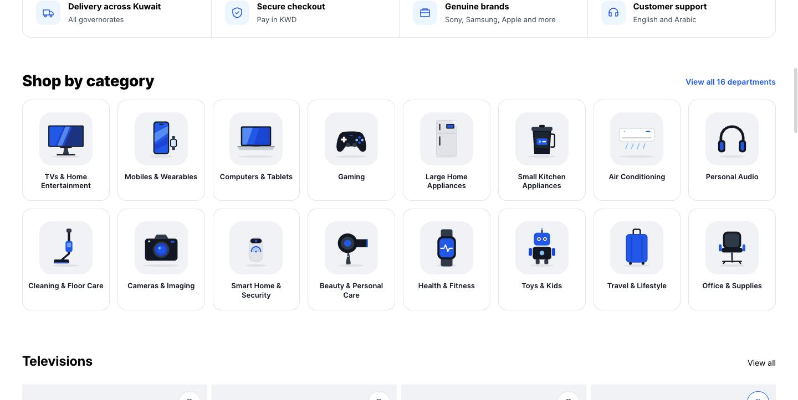
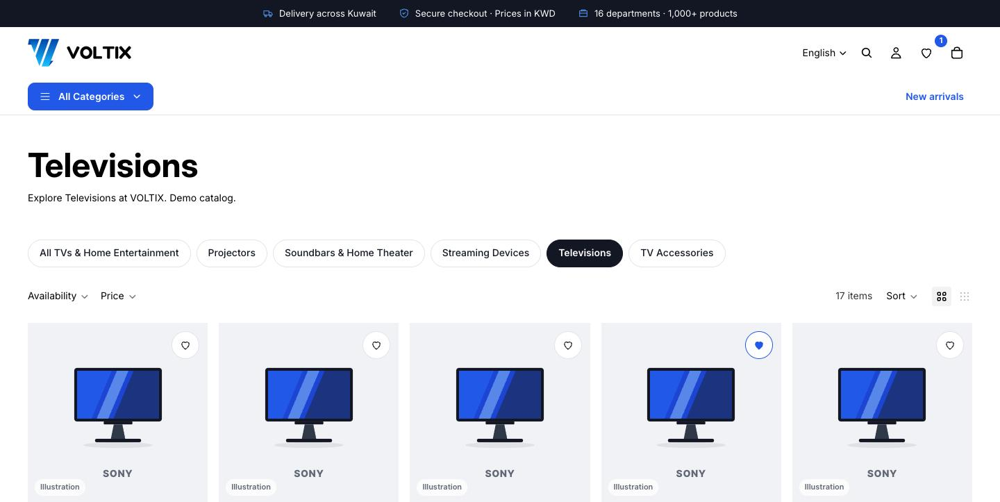
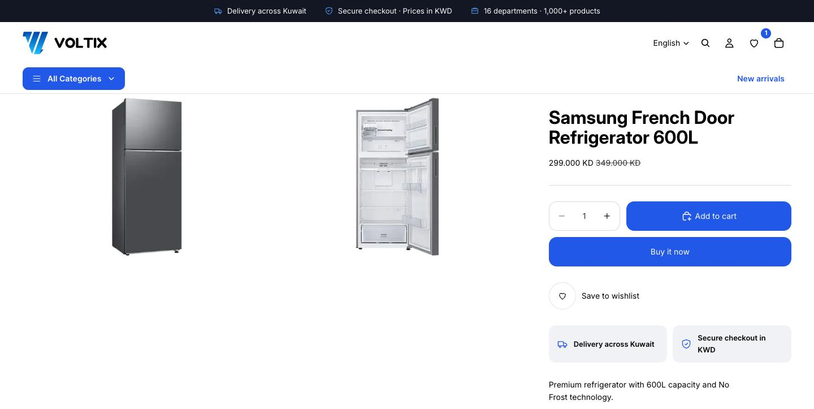
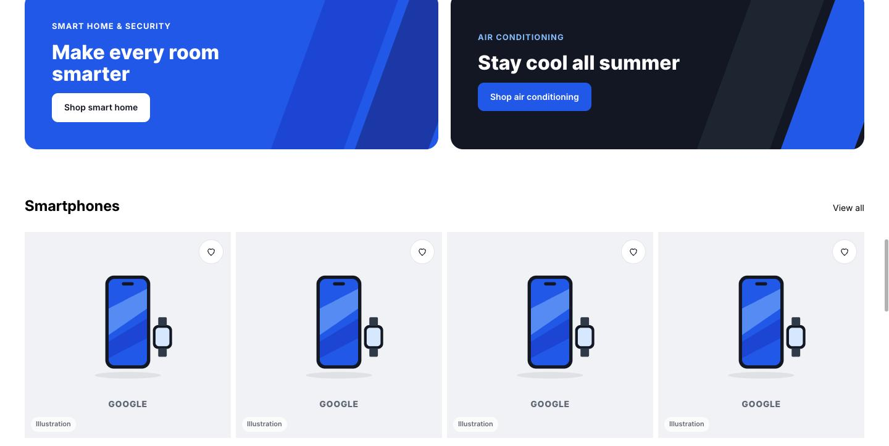
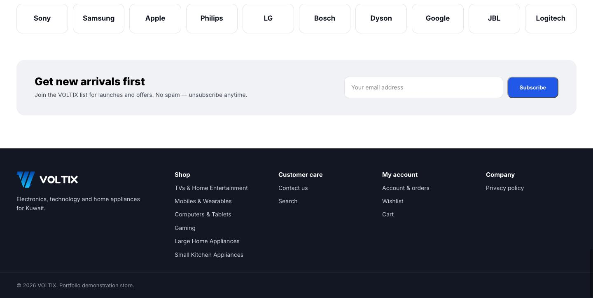
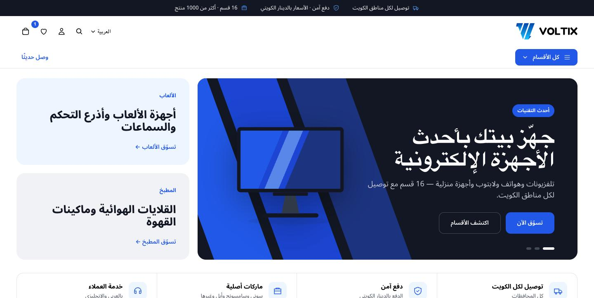
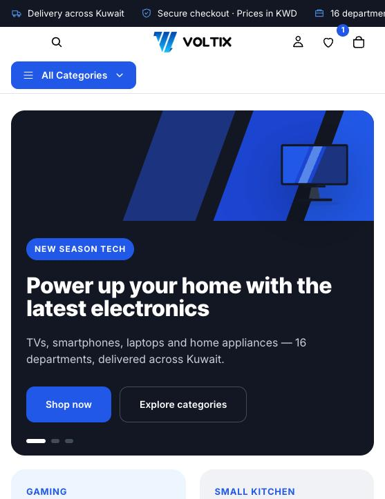
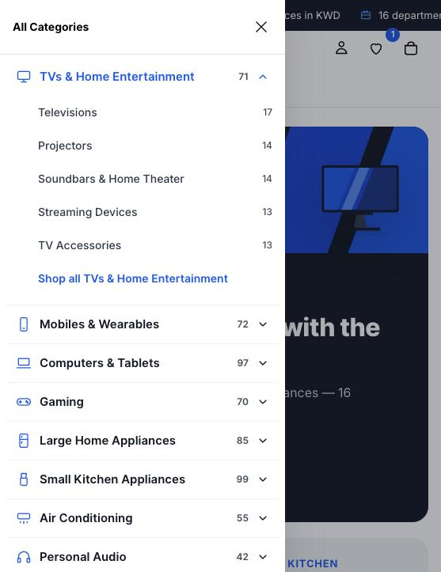

# VOLTIX — Shopify Electronics Storefront

A custom Shopify storefront for **VOLTIX**, a demonstration electronics and home-appliance retailer for Kuwait. Built on Shopify's Horizon theme with a custom brand layer, a 16-department mega menu, an app-free wishlist, original product illustrations and full English / Arabic (RTL) support.

> **Portfolio project.** VOLTIX is a fictional store. Prices, stock and fulfilment terms are demonstration data. Product names are used for illustration only, and product images are original VOLTIX illustrations, not manufacturer photos.



## Highlights

- **Mega menu for a large catalog** — 16 departments and 72 subcategories with product counts, an illustrated feature card, hover and keyboard navigation on desktop, and an accordion drawer on mobile. Every link comes from a collection picker in the theme editor, so there are no hard-coded URLs.
- **English and Arabic** — copy lives in locale files (`voltix.*` keys), collection names are translated, and the layout uses logical CSS properties so it mirrors automatically in RTL. Noto Sans Arabic loads only on Arabic pages.
- **Original illustration system** — 16 department illustrations in the brand palette, used for products without photos, the category grid, the hero and the mega menu.
- **Wishlist without an app** — heart buttons on product cards and product pages, a header counter and a wishlist page, stored in the shopper's browser.
- **Subcategory navigation** — collection pages show sibling subcategories as pills, generated from product tags.
- **Brand layer on top of Horizon** — all custom code lives in `voltix-*` files; changes inside Horizon files are a few documented lines (see `theme-customizations/horizon-integration.patch`).
- **Honest merchandising** — sale prices appear only when a real compare-at price exists; no fake countdowns or discounts.
- **Accessible** — 44px touch targets, visible focus states, ARIA on menus, toggles and sliders, AA colour contrast, reduced-motion support.

## Screens

| Desktop | |
|---|---|
|  |  |
|  |  |
|  |  |

| Arabic (RTL) | Mobile | Mobile menu |
|---|---|---|
|  |  |  |

Full homepage: [`docs/screenshots/00-homepage-overview.png`](docs/screenshots/00-homepage-overview.png)

## Store setup

| | |
|---|---|
| Market | Kuwait · KWD · Asia/Kuwait time zone |
| Languages | English (default) and Arabic |
| Catalog | About 1,000 demonstration products |
| Collections | 88 automated collections (16 departments, 72 subcategories) driven by product tags (`dept-*`, `sub-*`) |
| Shipping | Rules by product size (standard and large appliances) |

## Tech stack

Shopify Online Store 2.0 · Horizon theme · Liquid · JSON templates · Web Components (vanilla JavaScript) · CSS custom properties and logical properties · Shopify CLI · Theme Check · Git

## Repository layout

```
theme-customizations/
  assets/          voltix.css, voltix-mega-menu.js, voltix-wishlist.js, voltix-hero.js, illustrations (vx-illo-*.svg), logos
  sections/        hero, announcements, mega menu, category grid, services, promo banners, brands,
                   newsletter, footer, collection subcategory links, wishlist
  snippets/        icon set, translated text helper, collection title helper, wishlist button and grid, product placeholder
  templates/       page.wishlist.json
  locales/         en.voltix.json, ar.voltix.json (merge into the theme's locale files)
  config-snippets/ ready-made section settings for the homepage, header group and footer group
  horizon-integration.patch   the small edits made inside Horizon files
docs/
  screenshots/     store screenshots
  collections.csv, mega-menu-structure.json
```

The full theme (Horizon plus these files) is kept in a private repository. Horizon's licence allows modifying it for Shopify stores but not redistributing derived themes, so only the original VOLTIX code is published here.

## Using the customizations in a Horizon theme

1. Copy the files from `theme-customizations/assets`, `sections`, `snippets` and `templates` into the theme.
2. Merge `locales/en.voltix.json` into `locales/en.default.json` and `locales/ar.voltix.json` into `locales/ar.json`.
3. Apply `horizon-integration.patch` (loads the CSS and scripts, adds the wishlist icon, placeholder and translated titles).
4. Add the sections in the theme editor, or paste the objects from `config-snippets/`.
5. Preview with `shopify theme dev --store <store>.myshopify.com`.

## Key decisions

- **Collection pickers instead of a navigation API.** The mega menu is configured in the theme editor with collection and collection-list settings, which needs no extra app permissions and keeps product counts live.
- **Locale-first copy.** Section text settings fall back to translated locale strings when empty, so the store works in both languages out of the box and merchants can still override text.
- **Illustrations over stock photos.** The demo catalog has no product photography; brand-consistent illustrations keep the store looking finished without using manufacturer images.

## Author

**Ahmed Gamal** — E-commerce Manager & Web Developer
[LinkedIn](https://www.linkedin.com/in/ahmed-gamal-76321925a/)
